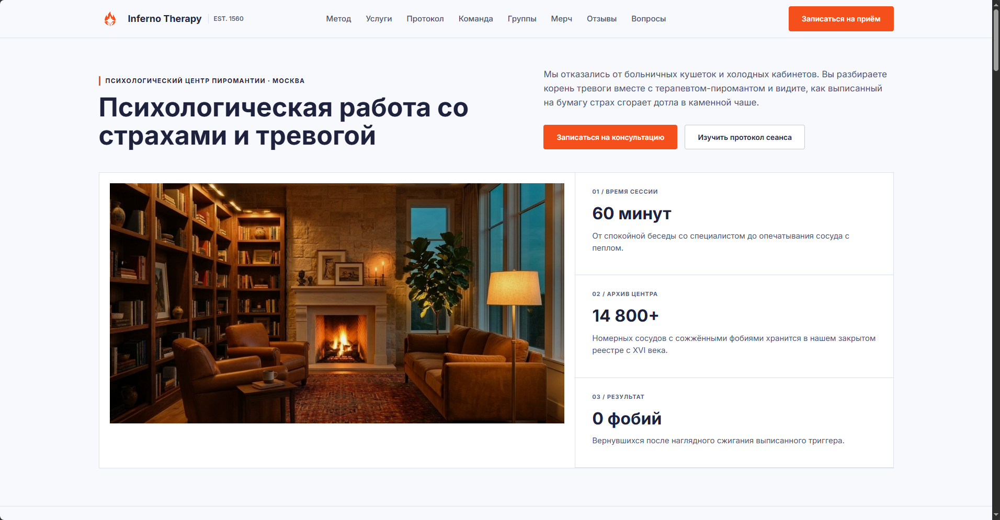

# Inferno Therapy

Сайт психологического центра пиромантии Inferno Therapy. Это проект про место со спокойной комфортной атмосферой, где людям помогают справляться со страхами и тревогой через терапию: признание и сожжение своих переживаний. На странице собрана основная инфа про сам метод, форматы терапии, этапы сеанса, команду, мерч и форма записи.

## Ссылка на сайт

[https://omniv3rsa.github.io/Inferno-Therapy/](https://omniv3rsa.github.io/Inferno-Therapy/)

## Скриншот

## Автор

Кузнецов Даниил Евгеньевич, группа БРИЦП262

## Что я научился делать

- Понял как вообще делить страницу на нормальные смысловые блоки и собирать их в общую структуру, чтобы сайт не разваливался.
- Научился выравнивать карточки в ряду по высоте через флексы, потому что сначала из-за разного количества текста кнопки внизу вечно смещались.
- Долго сидел с футером, никак не получалось выровнять левую и правую часть относительно логотипа по центру, в итоге дожал это через одинаковую минимальную высоту блоков и флексы.
- Разобрался как нормально вставлять картинки разных размеров в карточки, чтобы их не растягивало и не плющило.

## Использование ИИ

### Инструменты

| Инструмент  | Для чего использовал                              | Уровень помощи |
| ----------- | ------------------------------------------------- | -------------- |
| Gemini      | Объяснил как прижать кнопки к низу карточек       | 1              |
| Gemini      | Сделал закрепление шапки и выравнивание меню      | 3              |
| Gemini      | Помог собрать сетки через `grid-template-columns` | 3              |
| Gemini      | Подсказал `object-fit` и `object-position`        | 2              |
| Gemini      | Написал `@media` для адаптации под экраны         | 3              |
| Nano Banana | Сгенерировал почти все картинки для сайта         | 3              |

### Записи о запросах

#### Запись №1 · 25.10.2026

- **Что я хотел сделать:** хотел чтобы шапка сайта ехала вместе со скроллом страницы, а навигация стояла ровно по центру между логотипом и кнопкой записи.
- **Что я спросил:** как закрепить шапку вверху экрана при прокрутке и сделать так чтобы меню было строго по центру, если логотип слева шире чем кнопка справа?
- **Что ответил ИИ:** посоветовал поставить шапке `position: sticky` с `top: 0`, а внутри сделать сетку `grid-template-columns: 1fr auto 1fr` и развести края через `justify-self`.
- **Что я изменил сам:** подставил свои цвета фона и нижнюю границу, подобрал высоту шапки `72px` и отступы между ссылками в меню.
- **Как я понял, что это работает:** полистал сайт вверх-вниз в браузере, шапка остаётся на месте, а меню стоит ровно посередине.

#### Запись №2 · 25.10.2026

- **Что я хотел сделать:** нужно было сделать так, чтобы во всех разделах слева шёл узкий столбец с названием секции, а справа от него стояли карточки в 2, 3 или 4 колонки.
- **Что я спросил:** как сделать блок из двух неравных колонок (слева более узкая, справа всё остальное место) и внутри правой части разложить карточки ровными рядами?
- **Что ответил ИИ:** показал как работает `display: grid` и как делать одинаковые колонки через `repeat(3, 1fr)`.
- **Что я изменил сам:** раскидал это по простым классам `.section-grid`, `.grid-2`, `.grid-3` и `.grid-4`, чтобы не писать одно и то же для каждого блока отдельно, и поменял отступы `gap`.
- **Как я понял, что это работает:** открыл сайт на полном экране, все заголовки слева встали по одной линии, а карточки справа ровно поделили место.

#### Запись №3 · 26.10.2026

- **Что я хотел сделать:** картинки были разного размера и пропорций, и когда я ставил им фиксированную высоту в карточках, они сильно сплющивались.
- **Что я спросил:** почему картинка сжимается когда я пишу ей другие ширину и высоту? Как сделать чтобы она сама обрезалась под размер блока?
- **Что ответил ИИ:** написал что нужно добавить свойство `object-fit: cover`, а если обрезается нужное место на фото, то двигать через `object-position`.
- **Что я изменил сам:** прописал `object-fit: cover` всем классам картинок, а для толстых фоток в `.wide-img` поставил `object-position: center 65%`, чтобы было видно саму сцену, а не только верх.
- **Как я понял, что это работает:** перезагрузил страницу и проверил все карточки от первого экрана до мерча - ни одна фотка больше не растянута.

#### Запись №4 · 27.10.2026

- **Что я хотел сделать:** сделать адаптацию под маленькие экраны и телефоны, при сужении окна всё просто сжималось в кашу.
- **Что я спросил:** сделай адаптацию под другие экраны, чтобы сайт на всех дисплеях выглядел нормально и ничего не пропадало из виду.
- **Что ответил ИИ:** дал два блока `@media (max-width: 1180px)` и `@media (max-width: 720px)`, добавил туда скрытие верхнего меню `.nav` на маленьком экране и выравнивание текста в футере по левому краю, чтобы на узком экране подвал тоже не кривился.
- **Что я изменил сам:** ничего.
- **Как я понял, что это работает:** просто сжал окно браузера мышкой до узкой полоски и проверил что блоки спокойно встают друг под друга и ничего не уезжает за экран и не заезжает друг на друга.

### Выводы

Больше всего ИИ помог с вещами, которых я просто не знаю и не понимаю, но часто мне хватало просто загуглить как что-то делается. Нейронка в принципе не ошибается я думаю, зависит от того понятный промпт или нет. Вроде научился нормально верстать сетку, выравнивать сложные блоки во флексах, работать с карточками.